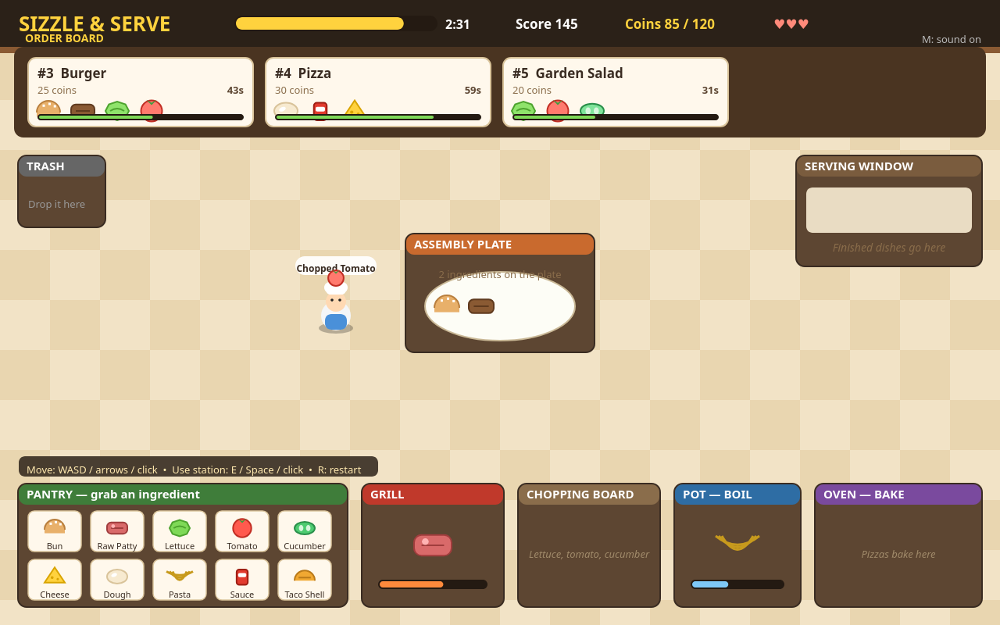

# Sizzle & Serve — a rush-hour cooking game

A complete original cooking game for the make.fun best-cooking-game bounty.
You run a tiny kitchen through a dinner rush: customers order from the board,
you grab ingredients from the pantry, grill patties, chop vegetables, boil
pasta, bake pizzas, build each dish on the assembly plate, and serve it at
the window before the order timer runs out.

## How it plays

- **Move** with WASD, the arrow keys, or a mouse click; **use a station**
  with E, Space, or a click on it.
- **Orders** appear on the board with a countdown. Serve the right dish in
  time for coins and a combo; an expired order costs a heart.
- **Prep matters**: patties grill (and burn if you forget them), lettuce,
  tomato and cucumber need chopping, pasta needs boiling, and a pizza needs
  the oven after assembly.
- **Win** by earning 120 coins in the 3-minute shift; lose all three hearts
  or fall short and the shift is over.

## Files

- `game/index.html` + `game/src/` — the whole game, plain static files,
  no libraries, no network requests, all art drawn in canvas.
- `screenshots/` — four real renders of the running game.
- `main.ts` — hands the game in: copies `game/` and `screenshots/` to
  `/output` and writes `dossier.json`.

Play it locally with `node serve.ts`, then open http://localhost:8080.
